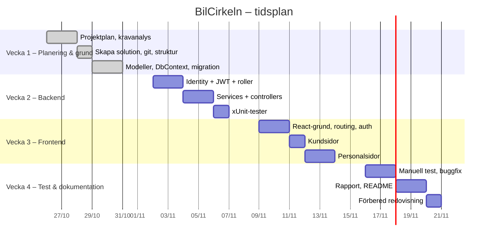

# Projektplan – BilCirkeln "Vi köper din bil"

## Bakgrund och problem
Att sälja bil privat tar tid och kan vara krångligt. Man måste skriva annonser, svara på frågor och ta emot provkörningar.
Bilhandlare som köper in bilar får förfrågningar via telefon och mejl, och då är det svårt att hålla ordning på dem.

## Mål
Bygga en fungerande webbapplikation där:
- en kund kan skicka in uppgifter om sin bil och följa förfrågan
- personal kan se förfrågningar och lämna bud
- kunden kan acceptera eller neka budet

Applikationen ska ha säker inloggning med roller, en databas och automatiska tester.

## Avgränsningar (ingår inte)
- Ingen riktig betalning eller avtalssignering
- Ingen bilduppladdning (finns under "kan ha")
- Ingen koppling till Transportstyrelsen för att hämta bildata automatiskt
- Ingen e-post/SMS-avisering
- Personalkonton skapas inte via appen, utan med en seed vid start
- Ingen driftsättning i molnet. Appen körs lokalt.

## Prioritering (MoSCoW)

### Måste ha
- [x] Registrering och inloggning med Identity + JWT
- [x] Roller: `Kund` och `Personal`
- [x] Kund: skicka in bil
- [x] Kund: se sina bilar och deras status
- [x] Personal: se alla förfrågningar
- [x] Personal: lämna bud
- [x] Kund: acceptera eller neka bud
- [x] Behörighetskontroll: kunden ser bara sina egna bilar
- [x] Databas med EF Core code first + migrations
- [x] xUnit-tester för affärslogiken
- [x] README, rapport, dagbok, beslutslogg

### Bör ha
- [x] Validering i både frontend och backend (regnr-format, årtal, pris)
- [x] Personal: filtrera på status
- [x] Personal: avböja en bil
- [x] Nytt bud efter att kunden nekat (budhistorik)
- [x] Hindra dubbla aktiva förfrågningar för samma regnr
- [x] Utloggning när token gått ut

### Kan ha (om tid finns)
- [ ] Bilduppladdning
- [ ] E-postavisering när ett bud lämnas
- [ ] Hämta bildata via regnr från ett externt API
- [ ] Kunden kan dra tillbaka sin förfrågan
- [ ] Integrationstester av controllers (WebApplicationFactory)
- [ ] Sidindelning (paging) av listor

## Tidsplan (4 veckor)

### Plan jämfört med verkligt utfall
Diagrammet ovan är den ursprungliga planen. I praktiken gick backend och frontend mycket snabbare med hjälp av AI, och redovisningen låg tidigare än planen räknade med (6/11). Den tid som blev över användes till att förbättra säljformuläret och till att förstå koden.

| Del | Planerat | Verkligt | Kommentar |
|---|---|---|---|
| Planering, struktur, datamodell | 26/10–30/10 | 29/10 | Klart på en dag |
| Backend: Identity, JWT, services, tester | 2/11–6/11 | 29/10 | Byggdes tillsammans med AI |
| Frontend: kund- och personalsidor | 9/11–13/11 | 29/10 | Byggdes tillsammans med AI |
| Ny design av säljformuläret + 10 nya frågor | Fanns inte i planen | 30/10 | Tillagt efter test i webbläsaren (beslut 14–19) |
| Förstå koden, förbereda redovisning | 20/11 | 3/11–5/11 | Tog mer tid än planerat |
| GitHub-inlämning | Dagen före redovisningen kl. 12 | 5/11 kväll | **Försenad.** Lärdom: pusha tidigt |
| Muntlig redovisning | – | 6/11 | Genomförd |
| Rapport klar | 16/11–19/11 | 7/11 | Skickad till läraren via mail |

Förändringar och beslut under arbetet finns i [beslutsloggen](beslutslogg.md).

## Risker
| Risk | Konsekvens | Åtgärd |
|---|---|---|
| JWT/Identity tar längre tid än planerat | Förseningar för frontend | Börja med auth tidigt (vecka 2) |
| Jag förstår inte AI-genererad kod | IG på redovisningen | Gå igenom [kodgenomgang.md](kodgenomgang.md), svara på kontrollfrågorna |
| Scope creep (för många funktioner) | Inget blir klart | Följ MoSCoW och gör "kan ha" först när allt annat är klart |
| Datorproblem / förlorad kod | Arbete försvinner | Pusha till GitHub ofta |

## Projektstyrning
- Varje arbetspass avslutas med en anteckning i [projektdagboken](projektdagbok.md).
- Viktiga beslut skrivs in i [beslutsloggen](beslutslogg.md).
- Prioriteringen ovan avgör vad som görs. *Måste ha* görs alltid först.
